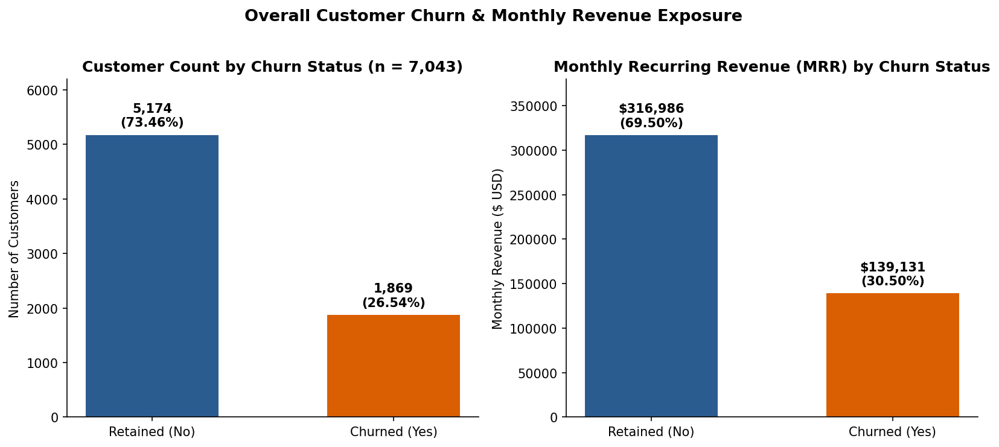

# Customer Churn Intelligence: End-to-End SQL, Python, ML & Power BI Portfolio Project



## 1. Executive Summary & Business Problem
Telecommunications providers face severe recurring revenue erosion from voluntary customer attrition. Using the uploaded **IBM Telco Customer Churn** dataset (`7,043` customers, `21` raw attributes), this project delivers an end-to-end **Customer Churn Intelligence System** spanning relational database ingestion (SQLite/PostgreSQL-ready), automated data quality auditing, statistical EDA, 16 reconciled SQL business queries, leak-free Scikit-learn machine learning pipelines, threshold-optimized retention economics, and a Star-Schema Power BI data model.

### Headline Measured Findings (Verified Across SQL & Python)
- **Customer Base & Churn Rate**: **7,043** total customers | **1,869** churned (**26.54%**) | **5,174** retained (**73.46%**).
- **Revenue Exposure**: Total Monthly Recurring Revenue (MRR) is **$456,116.60** (mean **$64.76**/customer). Churned customers represent **$139,130.85/month** in lost MRR (**30.50%** of total MRR), with a significantly higher average monthly bill (**$74.44** vs. **$61.27** for retained customers, Mann-Whitney $p = 3.31 	imes 10^{-54}$).
- **Primary Structural Churn Drivers**:
  1. **Contract Type**: Month-to-month contracts churn at **42.71%** (`1,655 / 3,875`) and drive **86.86%** (**$120,847.10**) of all churned MRR, vs. **11.27%** for One-year and **2.83%** for Two-year contracts.
  2. **Early Tenure Vulnerability**: The `0-12m` cohort churns at **47.44%** (`1,037 / 2,186`), with median churned tenure at **10.0 months** vs. **38.0 months** for retained customers.
  3. **Service & Support Gap**: Fiber Optic customers churn at **41.89%** (**$114,300.05** MRR lost), spiking to **49.37%** when lacking `TechSupport` (`No`) vs. **22.63%** with `TechSupport` (`Yes`).
  4. **Payment Friction**: `Electronic check` users churn at **45.29%** (`1,071 / 2,365`, **$84,288.75** MRR lost), nearly triple the **15.99%** churn rate of customers on automatic payments (`Is_AutoPay = 1`).

---

## 2. Repository Architecture
```text
customer-churn-intelligence/
├── data/
│   ├── raw/                        # SQLite DB (telco_churn.db) - git-ignored
│   ├── processed/                  # cleaned_churn.csv, data_dictionary.csv, powerbi/*.csv
│   ├── predictions/                # customer_risk_predictions.csv (7,043 scored customers)
│   └── README.md
├── notebooks/
│   ├── 01_database_inspection.ipynb
│   ├── 02_data_cleaning.ipynb
│   ├── 03_exploratory_analysis.ipynb
│   └── 04_model_evaluation.ipynb
├── src/
│   ├── __init__.py
│   ├── config.py                   # Environment-driven configuration & paths
│   ├── database.py                 # Read/write SQLite & PostgreSQL-compatible connector
│   ├── inspect_data.py             # Phase 1: DB ingestion & schema inspection
│   ├── clean_data.py               # Phase 3: Reproducible cleaning & feature engineering
│   ├── eda.py                      # Phase 4: Statistical EDA & 10 publication charts
│   ├── train_model.py              # Phase 6: Leak-free Scikit-learn training pipeline
│   ├── evaluate_model.py           # Phase 6: 5-Fold CV, test metrics & threshold curves
│   ├── predict_customers.py        # Phase 6: Customer risk scoring & tier assignment
│   └── export_powerbi.py           # Phase 7: Star-Schema CSV export for Power BI
├── sql/
│   ├── 01_schema.sql               # DDL & analytical view (vw_telco_cleaned)
│   ├── 02_data_quality.sql         # Null/blank TotalCharges & duplicate audits
│   ├── 03_customer_metrics.sql     # Headline customer, tenure & MRR KPIs
│   ├── 04_churn_analysis.sql       # Contract, tenure, payment & service breakdowns
│   ├── 05_customer_segmentation.sql# CASE-based risk matrix & support gap analysis
│   ├── 06_advanced_analysis.sql    # CTEs, DENSE_RANK(), NTILE(10) & retention queue
│   └── README.md                   # Query catalog & Python-SQL reconciliation table
├── models/
│   ├── churn_model_pipeline.pkl    # Serialized champion pipeline
│   └── training_metrics.json       # Verified CV & holdout evaluation metrics
├── visuals/                        # 14 PNG visualizations (EDA + ML evaluation)
├── reports/
│   ├── database_inspection.md
│   ├── data_quality_report.md
│   ├── findings.md
│   ├── model_evaluation.md
│   └── business_recommendations.md
├── powerbi/
│   ├── README.md
│   ├── measures.dax
│   ├── relationships.md
│   └── visual_mapping.md
├── tests/
│   ├── test_data_cleaning.py
│   ├── test_predictions.py
│   ├── test_metrics.py
│   └── test_data_schema.py
├── .github/workflows/tests.yml
├── .env.example
├── .gitignore
├── requirements.txt
└── LICENSE
```

---

## 3. Machine Learning Performance Summary
We compared **Logistic Regression** and **Random Forest** (`random_state=42`, stratified 80/20 train/test split: `5,634` train / `1,409` test rows, `47` encoded features after excluding `customerID`, `Churn`, `Churn_Binary`, and raw `TotalCharges` string):

| Model | 5-Fold CV ROC-AUC | Test ROC-AUC | Test PR-AUC | Test Accuracy (`t=0.50`) | Test Precision (`t=0.50`) | Test Recall (`t=0.50`) | Test F1 (`t=0.50`) |
| :--- | :---: | :---: | :---: | :---: | :---: | :---: | :---: |
| **Logistic Regression** | `0.8424 ± 0.0056` | `0.8575` | `0.6843` | `81.33%` | `69.07%` | `53.74%` | `0.6045` |
| **Random Forest (Champion)** | `0.8432 ± 0.0086` | **`0.8651`** | **`0.6869`** | `80.84%` | **`69.70%`** | `49.20%` | `0.5768` |

- **Operational Threshold Optimization**: Lowering the decision threshold from `0.50` to `0.25` increases recall on the holdout test set from **53.74% to 85.29%** (Logistic Regression) and **49.20% to 83.42%** (Random Forest), maximizing simulated net retention profit (**$33,625** vs. **$22,875** at `t=0.50`).

---

## 4. Quickstart & Verification Commands
```bash
# 1. Install dependencies
pip install -r requirements.txt

# 2. Run the full pipeline
python3 -m src.inspect_data
python3 -m src.clean_data
python3 -m src.eda
python3 -m src.evaluate_model
python3 -m src.predict_customers
python3 -m src.export_powerbi

# 3. Run the automated QA test suite (16 unit & integration tests)
python3 -m unittest discover -s tests -v
```
